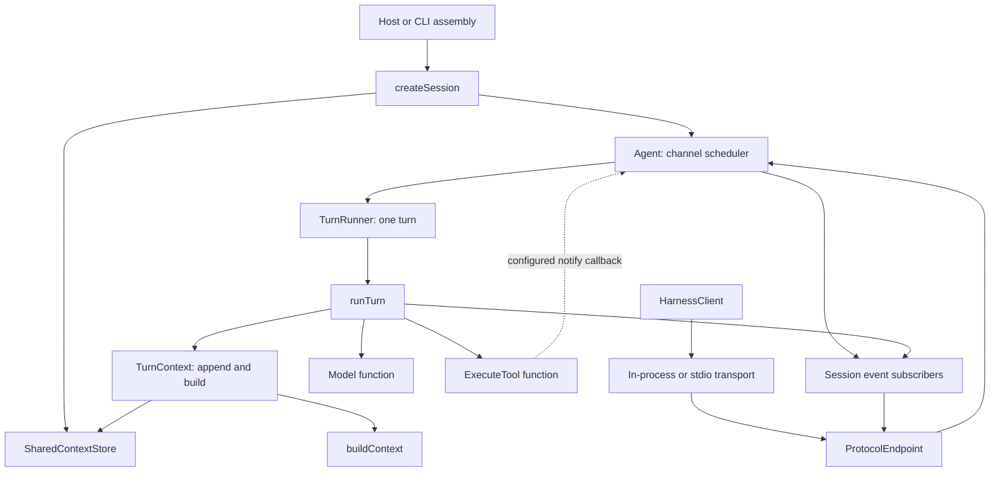

# Technical architecture

Status: current code, 2026-11-16. SQLite is proposed separately in
[Persistence](persistence.md); none of the objects below is durable today.

## Runtime structure

Most of the harness uses factory functions returning objects and closures rather
than classes. The important runtime container is `HarnessSession`, returned by
`createSession(options)`. It contains the scheduling API (`agent`), the shared
conversation store (`store`), and an event subscription API (`subscribe`). It is
not a model connection or a single inference context.

The diagram shows runtime calls and data flow. Entry-point composition wires
these connections; an arrow does not mean one module imports the other.



The development HTTP/socket adapters also call `Agent` directly. They do not
pass through `HarnessClient` or the experimental JSON-RPC endpoint.

## Main objects and functions

Paths below are relative to the package's `src/` directory.

| Name | Code | Responsibility and lifetime |
| --- | --- | --- |
| `createSession` | [index.ts](../../src/index.ts) | Composition function. Chooses a store, connects the scheduler to the loop, and owns session event listeners. |
| `HarnessSession`, `SessionOptions` | [contracts/session.ts](../../src/contracts/session.ts) | Public container and injected configuration. `configureTurn` supplies model/tool services when a queued turn starts. |
| `Agent` | [contracts/agent.ts](../../src/contracts/agent.ts) | Scheduling API: `send`, `notify`, `idle`. Routing and participant attribution are separate from authentication. |
| `createChannelScheduler` | [kernel/channels.ts](../../src/kernel/channels.ts) | Session-scoped channel map, queues, turn counters and active notice inboxes. Returns the `Agent` object. |
| `TurnRunner`, `TurnMailbox` | [contracts/agent.ts](../../src/contracts/agent.ts) | Bridge between scheduling and execution. The runner receives turn identity and mailbox operations. |
| `runTurn` | [kernel/loop.ts](../../src/kernel/loop.ts) | Executes inference/tool iterations for one turn. Receives services through contracts. |
| `TurnContext` | [contracts/context.ts](../../src/contracts/context.ts) | Turn-scoped facade for storing messages, building context, draining notices and emitting events. Assembled in `createSession`. |
| `SharedContextStore` | [contracts/context.ts](../../src/contracts/context.ts) | Session-wide attributed history: append, snapshot and subscribe. |
| `createSharedContextStore` | [state/storage/shared-context.ts](../../src/state/storage/shared-context.ts) | In-memory implementation with sequence allocation and deep copies. |
| `buildContext`, `buildSharedContext` | [capabilities/context/build.ts](../../src/capabilities/context/build.ts) | Pure rendering functions. Produce a per-turn request view or a channel-independent base. |
| `Model`, `ExecuteTool`, `Message` | [contracts/loop.ts](../../src/contracts/loop.ts) | Neutral inference, execution and history types. Tools are executed outside the model function. |
| `createProtocolServer` | [interfaces/protocol/server.ts](../../src/interfaces/protocol/server.ts) | Validates RPC operations, creates a session through an injected factory and converts session events to notifications. |
| `HarnessClient` | [interfaces/client.ts](../../src/interfaces/client.ts) | Class that correlates requests/responses, applies timeouts and exposes channel event subscriptions. |

## How assembly connects them

`createSession` creates the default shared store unless the caller supplies one.
It then defines a `TurnRunner` closure and passes it to the channel scheduler.
That closure captures the store, system prompt, service factory and event emitter.

When a queued turn starts, the runner calls
`options.configureTurn(input, notify)`. The resulting `TurnServices` contains a
model function, tool definitions and tool executor. The callback lets configured
tools send notices through the same scheduler without importing it.

The runner constructs a `TurnContext` for that turn:

- `append` adds channel/turn/sender attribution before writing to the shared store.
- `build` reads a fresh snapshot and calls `buildContext` with the turn identity.
- `drainNotices` and `finish` delegate to the scheduler's mailbox.
- `emit` adds channel, turn and message IDs before notifying session subscribers.

It passes that facade and the configured services to `runTurn`. An optional
`wrapTurn` decorates the runner; development inspection uses this to track active
execution. The kernel therefore needs neither rendering nor storage imports.

## One message through the experimental protocol

Initialization and session creation precede this sequence. `session/create`
invokes the endpoint's injected factory, which ultimately calls `createSession`.

```mermaid
sequenceDiagram
    participant C as HarnessClient
    participant P as Protocol endpoint
    participant A as Channel scheduler
    participant S as Shared store
    participant L as Turn runner and loop
    participant M as Model
    participant T as Tool executor
    C->>P: channel/push with item ID and sender
    P->>A: send(input)
    A->>S: Append input with allocated turn ID
    P-->>C: accepted (does not wait for inference)
    Note over A,L: Run when this channel's previous turn settles
    A->>L: run(input, mailbox)
    loop Each inference iteration
        L->>S: Drain notices and read fresh snapshot
        Note over L: Build attributed shared history plus native active turn
        L->>M: model(messages, tool definitions)
        M-->>L: Assistant response and tool calls
        L->>S: Append assistant response
        opt Response contains text
            L-->>P: message_completed event
            P-->>C: channel/event notification
        end
        opt Response requests tools
            L->>T: Execute each call sequentially
            T-->>L: Serialized result
            L->>S: Append paired tool result
        end
        Note over L: Continue after tools or pending explicit notices
    end
    L-->>A: Final answer; mailbox admission closed
    A-->>P: turn_ended event
    P-->>C: channel/event notification
```

This sequence shows the normal successful path. Tool activity and turn-start
events are also published. Failure produces a failed turn event and blocks that
channel. Input validation or transport failure can reject the request before
execution.

The endpoint's `accepted` response currently means in-memory acceptance. Its
deduplication map also lives only in that endpoint. The scheduler's `send` promise
resolves when the whole turn finishes; the protocol deliberately does not await
it before acknowledging input.

## State ownership and concurrency

| Scope | State |
| --- | --- |
| Session | Shared store, event listeners, system prompt and service factory |
| Scheduler | Channel map, turn/notice counters and total pending-turn count |
| Channel | Promise queue, failure flag and reference to the active turn |
| Active turn | Input identity, pending notices, admission flag and message counter |
| Inference | Newly built message array and returned assistant response |
| Protocol endpoint | Initialization/subscription settings, session reference, participant set and accepted-item signatures |
| Capability implementation | Any model/tool-specific state, such as script position or dashboard progress |

A channel is currently a scheduler map entry, not a separate `Channel` class.
There is no autonomous thread per channel. Promise chains serialize a channel's
turns, while awaited model/tool operations allow other channels to progress.
The shared store orders synchronous appends across those executions.

Every inference gets a fresh snapshot; requests already in flight retain their
older snapshot. A notice to a busy accepting channel enters its mailbox. A notice
to an idle known channel queues a turn. See [Execution](execution.md) for the
atomic finish check and failure behavior.

## Observation and development interfaces

[interfaces/cli/start.ts](../../src/interfaces/cli/start.ts) composes the live
development setup. It supplies OpenRouter and scenario tools, then connects:

- Session events to channel output subscriptions used by terminal and web clients.
- `observeContext` to store changes, updating shared history and live context.
- `observeModel` to serialized provider requests and returned model responses.
- `observeTurn` to running-turn status and `observeAgent` to submitted inputs.

These wrappers live in
[interfaces/inspector/observe.ts](../../src/interfaces/inspector/observe.ts).
Inspection state is a separate in-memory projection, not the history authority.
The inspector server reads that projection; it does not drive inference.

[testing.ts](../../src/testing.ts) is a different assembly using scripted models
and an echo tool. Both the in-process test client and stdio CLI reuse its
protocol server factory. Transport framing changes how messages travel, not how
the session executes them.

## Where persistence will attach

Storage already has an injection point, but swapping its implementation alone
cannot restore scheduler counters, channel status, queues or pending notices.
The persistence increment must extend contracts and assembly to restore those
facts explicitly. Context rendering and transport framing should continue to
consume neutral data without SQLite dependencies. This is proposed work, not a
current restart guarantee.
